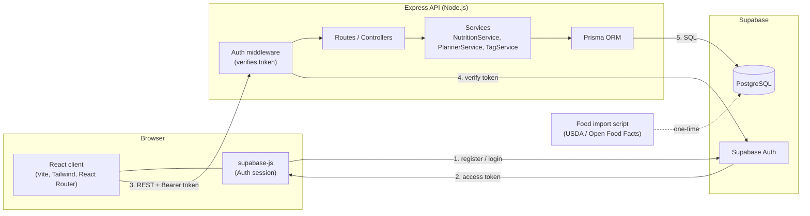

# System architecture (draft v1)

Three layers: a React frontend in the browser, an Express REST API that holds the business logic, and Supabase (PostgreSQL + Auth).

## Components

| Component | Responsibility | Status |
|---|---|---|
| React client | Pages for foods, recipes, nutrition profile, planner; login/register | Auth + routing done (Sprint 1) |
| Auth middleware | Reads the Bearer token, verifies it with Supabase, sets `req.user` | Done (Sprint 1) |
| Routes / controllers | HTTP layer for foods, recipes, tags, profile, meal plans | `/health`, `/me` done |
| NutritionService | Recipe totals and per-portion values, daily totals | Sprint 2 |
| PlannerService | Suggests meals and portions, flags allergen conflicts | Sprint 5 |
| TagService | Create/rename/remove tags, delete unused tags | Sprint 3 |
| Prisma | Database access and migrations | Schema written (Sprint 1) |
| Supabase | PostgreSQL and user authentication | Project to be created |

## Data flow for a request

1. The user logs in through Supabase Auth in the browser and receives an access token.
2. The client sends the token with every API request (`Authorization: Bearer <token>`).
3. The middleware verifies the token and identifies the user; invalid or missing tokens get `401`.
4. The controller calls a service, the service reads/writes through Prisma, and every query is filtered by the user's id so users only get their own data.
