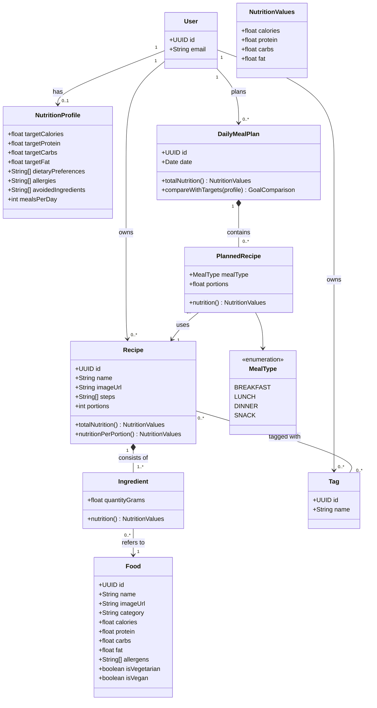
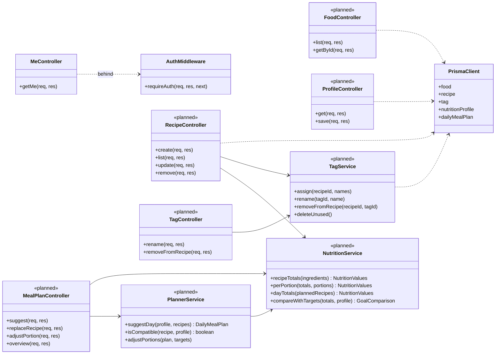

# Class diagrams (draft v1)

Two views are prepared; to confirm with the lecturer which kind is expected.

## 1. Domain (conceptual) class diagram

## 2. Backend design (implementation) class diagram

Layers: routes/controllers (HTTP), services (business logic), Prisma (data access). Items marked *planned* come in later sprints.

